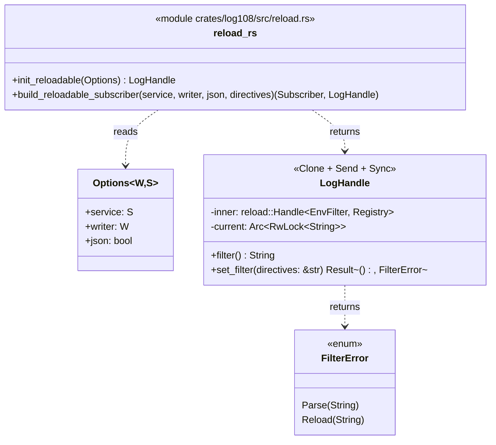

# Runtime log filter (LOG-3)

Status: design, 2026-11-15, lane controller `claude/b96dfcba` (lane notice: #6).

## Why

The owner's words, 2026-11-13 08:22–08:23 ICT: *"ทำ logs ให้ดี"* · *"เพิ่ม logs อย่างละเอียด ทุก ระบบ"* · *"แล้ว ให้สามารถ ปิด logs ได้"* · *"เมื่อ ขึ้น production"*.

Today `log108::init` reads `RUST_LOG` / `LOG_FILTER` once at boot (`crates/log108/src/lib.rs`, `build_env_filter`). Changing the level means a restart. bank-bot#996 asks for a per-subsystem switch on a running process, with a production default of `warn`. That switch belongs in the shared crate so every service gets it the same way. It should not be re-implemented per service.

## What changes

`log108` gains a reloadable filter and a cloneable handle to it. The HTTP route that calls the handle stays in each service, because auth and peer rules differ (bank-bot is actix, others are axum). The crate does not add an admin route.

- `init_reloadable(options)` does what `init_with` does, but wraps the `EnvFilter` in `tracing_subscriber::reload::Layer` and returns a `LogHandle`.
  - The initial directives use the same precedence as today: `RUST_LOG` → `LOG_FILTER` → `info`.
  - Calling it a second time does not install a second subscriber. It returns a handle that controls nothing, and `set_filter` on that handle returns `FilterError::Reload`.
- `build_reloadable_subscriber(...)` is the testable form. It returns the subscriber and the handle, and installs nothing globally.
- `LogHandle::set_filter(directives)` parses the string as `EnvFilter` directives (`warn,mqtt=debug`). If it parses, it swaps the filter and records the string. If it does not parse, it returns `FilterError::Parse` and **leaves the old filter and string untouched**.
- `LogHandle::filter()` returns the directive string currently in force.
- `init` and `init_with` stay as they are (no reload layer), so existing callers do not change.

### Subsystem = target

A subsystem is a `tracing` target, written as `target: "mqtt"` on the event. Per-subsystem levels are therefore ordinary directives (`warn,mqtt=debug,screenlink=info`), and no new config shape is needed. In JSON the target is the existing `target` field. Services add an `ev` field for the event name (`connect`, `disconnect`, `look_start`…). The board firmware (ScreenLink#357) uses the same `sub`/`ev` names in its own line format, so a collector can join the two on `sub` == `target`.

### Cost when off

`reload::Layer` adds one `RwLock` read per callsite-interest check. `tracing` caches interest, and a reload calls `rebuild_interest_cache`. An event below the filter therefore still costs only the level check: no formatting and no allocation.

## Behaviour

| Case | Required |
|---|---|
| Built with `"warn"`, then `debug!(target: "mqtt", …)` | not written |
| `set_filter("warn,mqtt=debug")`, then `debug!(target: "mqtt", …)` | written |
| Same, then `debug!(target: "http", …)` | not written |
| `set_filter("warn,mqtt=nonsense[")` | `Err(Parse)`, `filter()` still `"warn,mqtt=debug"`, the mqtt debug line is still written |
| `filter()` right after build with `"warn"` | `"warn"` |
| Redaction, JSON schema, `request_id` | unchanged; the existing tests stay green |

## Provided tests (written before the code, `crates/log108/src/reload.rs` `#[cfg(test)]`)

1. `reload_raises_one_target_without_restart`: rows 1–3 of the table.
2. `bad_directive_keeps_the_old_filter`: row 4.
3. `filter_reports_the_directives_in_force`: row 5.

Each test uses `tracing::subscriber::with_default` and an in-memory writer, as the existing tests in `lib.rs` do. None of them installs a global subscriber.

## Consumers

- bank-bot#996 drops its own `tracing-subscriber` init and reload code. It calls `log108::init_reloadable("bank-bot")`, keeps the `GET`/`PUT /admin/log` route (loopback or `screenlink.allow_ip`) calling `LogHandle`, and reads its boot default from `log.filter` (cloud: `warn`).
- ScreenLink#357 (ESP32 firmware) cannot use this host crate. It shares only the target and event names and the field names.
